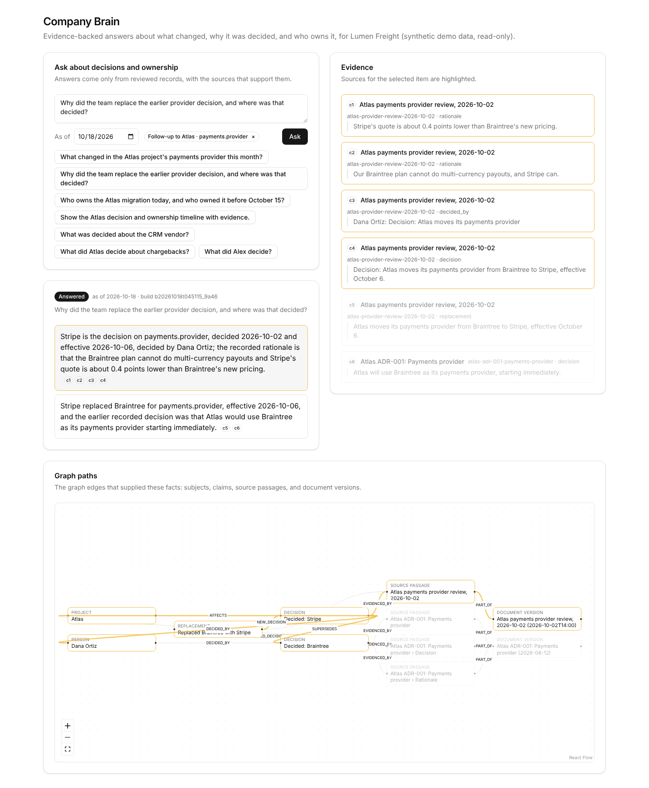

# Company Brain

A decision and ownership assistant for one company. Ask what changed in a project, why a decision
was made, who is responsible now or on a given date, or how the history unfolded. Every answer
shows the source passages it rests on and the graph paths that supplied its facts. When the records
are ambiguous, conflicting, or silent, it says so instead of guessing.

The demo runs on **Lumen Freight**, a synthetic company: 3 projects and 14 sources (3 CSV registers,
8 Markdown documents, 3 meeting notes). They cover a decision replacement, an ownership handoff, an
unapproved proposal, an ambiguous name, a future-dated change, an ownership conflict, and a decision
with no recorded rationale. It is read-only: ingestion, review, and graph activation are CLI-only.



More screenshots: [timeline](docs/screenshots/q4-timeline.png),
[clarification](docs/screenshots/alex-clarify.png),
[insufficient evidence](docs/screenshots/q5-insufficient.png),
[phone width](docs/screenshots/mobile.png), [rate limit](docs/screenshots/rate-limited.png).

## How it works

1. **Ingest (batch, CLI).** Sources are versioned and chunked into Postgres, the system of record.
   The facts the demo answers from are reviewed claims:
   - each claim is a decision, proposal, replacement, ownership assignment, or handoff;
   - each claim cites exact quoted spans;
   - each is validated before it is approved.

   `gpt-5-mini` can also extract claims from the prose (`pnpm extract`), with every proposal reviewed
   in a versioned approvals file. A build from the reviewed extracted claims passes the same 24
   expected-answer cases. The demo runs on a curated set of fixture claims written from the sources
   (see the [AI disclosure](docs/ai-disclosure.md)).
2. **Project.** Each build writes approved claims into a fresh FalkorDB graph and runs integrity
   checks. Only a build that passes its checks becomes active, so a failed build never replaces a
   working one.
3. **Ask.** One model call proposes a plan: intents, names, topics, and time words.
   - The server resolves the plan against the registry, or asks a clarifying question.
   - It runs at most three fixed, parameterised graph queries on one pinned build. No model writes
     a query.
   - When a question names no known topic, a hybrid full-text and vector search finds one. A topic
     only counts if a full-text match backs it up ([ADR 0005](docs/adr/0005-search-requires-lexical-corroboration.md)).
4. **Answer.** The model writes answer items from a bounded evidence packet.
   - Server checks reject unsupported names, dates, choices, citations, one-sided conflicts, and
     reasons the sources never gave.
   - A failing answer gets one repair. If that also fails, the answer is the verified facts stated
     plainly.
   - If the graph is down, the answer is `unavailable`. There is no fallback chatbot.

Outcomes are always one of: `answered`, `partial`, `needs_clarification`, `conflicting_evidence`,
`insufficient_evidence`, `unavailable`.

Details: [architecture](docs/architecture.md), [ingestion flow](docs/design-flow/ingestion.md),
[query flow](docs/design-flow/query.md), [ADRs](docs/adr/), [glossary](GLOSSARY.md).

## Run it

Requires Node 22, pnpm 10, and Docker with Compose.

### Without a model provider (free)

Everything except natural-language questions works offline: data loading, graph builds, the fixed
graph tools, and the evaluation against hand-written expected answers.

```bash
pnpm bootstrap                       # Docker services, locked deps, migrations (safe to rerun)
pnpm data:load && pnpm graph:publish # load the synthetic company, activate a checked graph build
pnpm demo                            # the demo questions as structured requests, with evidence
pnpm eval                            # 24 expected-answer cases against the active build
pnpm test                            # unit + integration tests (real Postgres and FalkorDB)
pnpm check                           # services, tests, typecheck, lint, build, bundle scan, HTTP check
```

If `OPENAI_EMBEDDING_MODEL` and `OPENAI_EMBEDDING_DIMENSIONS` are set in your shell, a build needs a
cached vector for every chunk. Either run `pnpm embed` (paid) first, or unset both variables to build
without vectors. Without vectors, search uses full-text matching only.

### With a model provider (paid)

1. Copy `.env.example` to `.env.local` and set `OPENAI_AUTH_MODE=api_key` and `OPENAI_API_KEY`.
   Next.js reads `.env.local`. The CLI scripts read only the process environment, so export it
   first: `set -a; . ./.env.local; set +a`.
2. Run:

```bash
pnpm check:provider                  # one tiny completion and one embedding
pnpm embed && pnpm graph:publish     # embed the 45 chunks once (cached), rebuild with vectors
pnpm build && pnpm start             # http://127.0.0.1:3000
pnpm ask "Who owns the Atlas migration today?" --steps
pnpm eval:questions                  # 24 hand-written questions through the real planner
```

Models: `gpt-5-mini` (planning and answer wording) and `text-embedding-3-small` (1536 dimensions).
A typical answer takes 6-13 s, or about 20 s when a repair is needed.

### Questions to try

- What changed in the Atlas project's payments provider this month?
- Why did the team replace the earlier provider decision, and where was that decided? (a follow-up to the question above)
- Who owns the Atlas migration today, and who owned it before October 15?
- Show the Atlas decision and ownership timeline with evidence.
- What was decided about the CRM vendor? (nothing is recorded)
- What did Alex decide? (two people are called Alex)

The data is dated around October 2026. The "As of" date defaults to today, so answers about "now"
change after the dated events (for example, Beacon's analytics switch on 2026-11-01). Set the date
to 2026-10-18 to see the answers the evaluations expect.

## Public-demo limits

`POST /api/question` refuses requests before any model call when any of these is exceeded:
- body larger than 4 KB → `413`;
- more than 3 questions in flight → `429` with `Retry-After`;
- more than 10 questions per client in 10 minutes → `429` with `Retry-After`;
- more than 500 questions per UTC day → `429` with `Retry-After`.

All are configurable (see `.env.example`). Clients are told apart by `X-Forwarded-For` only with
`TRUST_PROXY=1`. Old build graphs are removed with `pnpm graph:prune`, which keeps the active build
and one rollback build.

## Verification and limitations

[docs/verification.md](docs/verification.md) maps each acceptance check to the tests and
expected-answer cases that cover it, with the latest results. Known limitations:
- No tool answers person-centric questions ("What does Marcus own?"); they get a clarification or
  `insufficient_evidence`.
- The planner's wording varies between runs. The server resolves every plan, but a wrong plan that
  still resolves cleanly is possible.
- Rate limits are in memory, per server process.
- The demo's active build uses the curated fixture claims. Extracted claims are available as a
  separate build (`pnpm graph:publish --claims extracted`); their review decisions were drafted by
  Claude Code and await the owner's confirmation.
- Not deployed.

## AI assistance

This project was built with Claude Code and uses OpenAI models at runtime. What each did, and what
the server guarantees regardless: [docs/ai-disclosure.md](docs/ai-disclosure.md).

## Repository map

[context-map.md](context-map.md) lists where everything lives. Development setup, every command,
and configuration: [docs/dev-environment.md](docs/dev-environment.md). Plan and status:
[docs/project-plan.md](docs/project-plan.md).
