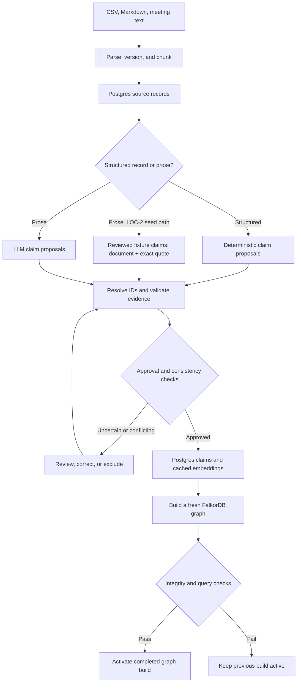

# Ingestion and graph activation flow

Source of truth for this flow. Read it before changing ingestion, extraction, review, embedding,
projection, or activation code, and update it in the same change. Step details:
[architecture.md §3](../architecture.md#3-ingestion-and-graph-activation-flow).

Status: parse/version/chunk, structured claims, and the reviewed-fixture seed path exist (LOC-2,
`src/ingest/`, `src/extract/`). LLM proposals, review reports, and embeddings are LOC-3; graph build
and activation are the next LOC-2 issue.

## Invariants

- Document versions and chunks are immutable; re-ingesting identical content creates nothing new.
- Structured CSV rows skip the LLM but still pass schema, identity, date, and consistency validation.
- Reviewed fixture claims are the LOC-2 stand-in for reviewed extraction output. They cite evidence as
  document + exact quote; seeding resolves each quote to exactly one chunk of the selected version.
- Seeding is all-or-nothing: one invalid claim rejects the whole set and nothing is written.
- Only approved claims reach the graph. `review_status` is separate from a decision's business lifecycle.
- `rebuild-graph` makes no LLM or embedding calls; it reads cached records and vectors from Postgres.
- Every build goes into a fresh graph; the active pointer moves only after integrity and query checks pass.
