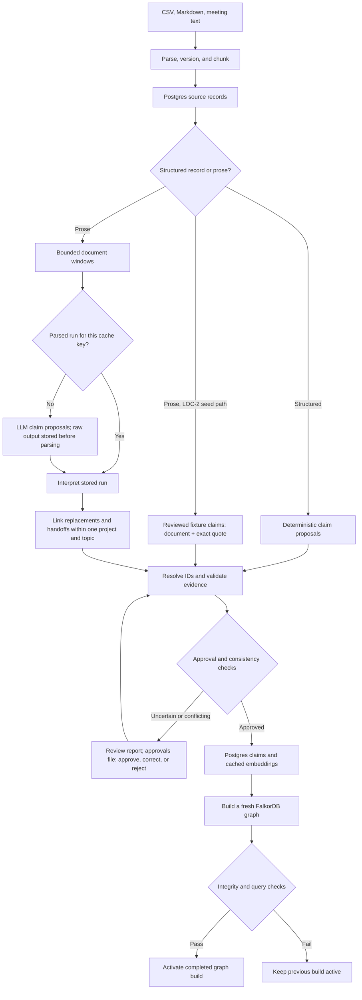

# Ingestion and graph activation flow

Source of truth for this flow. Read it before changing ingestion, extraction, review, embedding,
projection, or activation code, and update it in the same change. Step details:
[architecture.md §3](../architecture.md#3-ingestion-and-graph-activation-flow).

Status: parse/version/chunk, structured claims, the reviewed-fixture seed path, build/check/activation
(LOC-2), and the extraction path (LOC-3, #8: windows, cached runs, interpretation, linking, review)
exist in `src/ingest/`, `src/extract/`, `src/graph/`. The live model adapter is **not verified**
until #2 is fixed; embeddings are the next LOC-3 issue.

## Invariants

- Document versions and chunks are immutable; re-ingesting identical content creates nothing new.
- Structured CSV rows skip the LLM but still pass schema, identity, date, and consistency validation.
- Reviewed fixture claims are the LOC-2 stand-in for reviewed extraction output. They cite evidence as
  document + exact quote; seeding resolves each quote to exactly one chunk of the selected version.
- Seeding is all-or-nothing: one invalid claim rejects the whole set and nothing is written.
- An extraction cache key covers the window content, chunker versions, schema and prompt versions,
  model, and registry revision; only a `parsed` run is reused, `failed`/`invalid` runs are retried.
- Extracted claims are re-derived from stored runs plus the approvals file on every `extract` or
  `review:apply`, so claim IDs and reviewer decisions are stable. Proposals that fail evidence or
  window checks never become claims; claims that fail validation stay `pending`, even if approved.
- A build projects one claim set: `fixture` (structured + fixture_reviewed) or `extracted`
  (structured + extracted). The two prose paths never mix in one graph.
- Only approved claims reach the graph. `review_status` is separate from a decision's business lifecycle.
- `rebuild-graph` makes no LLM or embedding calls; it reads cached records and vectors from Postgres.
- Every build goes into a fresh graph; the active pointer moves only after integrity and query checks pass.
- A build fails fast if an approved claim cites a chunk outside the selected versions (re-seed claims).
- Ownership ends only at a stated end or an evidenced handoff; overlapping exclusive assignments are
  reported as conflicts in the build's integrity record, not resolved.
