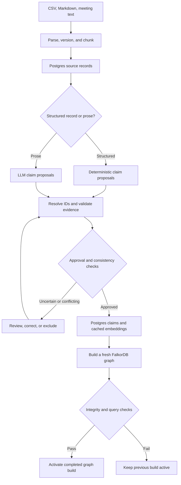

# Ingestion and graph activation flow

Source of truth for this flow. Read it before changing ingestion, extraction, review, embedding,
projection, or activation code, and update it in the same change. Step details:
[architecture.md §3](../architecture.md#3-ingestion-and-graph-activation-flow).

Status: not implemented yet (planned for LOC-2 and LOC-3 in [project-plan.md](../project-plan.md)).

## Invariants

- Document versions and chunks are immutable; re-ingesting identical content creates nothing new.
- Structured CSV rows skip the LLM but still pass schema, identity, date, and consistency validation.
- Only approved claims reach the graph. `review_status` is separate from a decision's business lifecycle.
- `rebuild-graph` makes no LLM or embedding calls; it reads cached records and vectors from Postgres.
- Every build goes into a fresh graph; the active pointer moves only after integrity and query checks pass.
