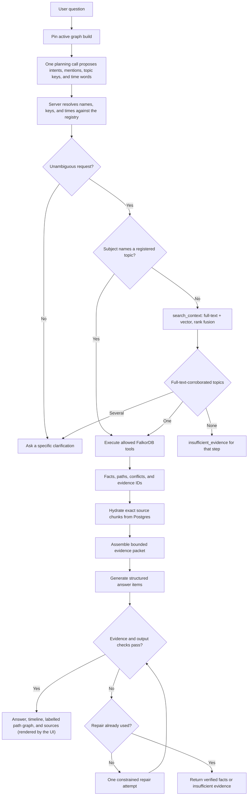

# Query and answer flow

Source of truth for this flow. Read it before changing planning, graph tools, evidence packets,
answer validation, or response shape, and update it in the same change. Step details:
[architecture.md §6](../architecture.md#6-query-and-answer-flow).

Status: pinning, the fixed tools, hydration, and deterministic rendering (LOC-2), plus
natural-language planning, deterministic resolution, multi-step execution on one pinned build, and
`qa_logs` (LOC-4, #12: `src/retrieve/ask.ts`, `resolve-plan.ts`, `plan-prompt.ts`), and the
evidence packet, generated answers, server checks, one repair, deterministic fallback, and
`POST /api/question` (#13: `src/answer/`), and `search_context` for subjects that name no
registered topic (#14: `src/retrieve/search.ts`). The home page renders the response (#16: `src/components/`):
answer items, timeline, evidence, and the returned path edges.

## Invariants

- One graph build is pinned for the whole request.
- Business facts come from fixed, parameterised FalkorDB tools; Postgres only resolves aliases and
  hydrates exact chunk IDs. There is no Postgres answer path when the graph is unavailable.
- Tool inputs are validated before any query runs; the server picks the build and graph name.
- The planner only proposes. Project IDs, topic keys, and times are accepted only after the server
  resolves them against the registry; an ambiguous person or project yields a clarification with
  candidates, an unknown subject yields `insufficient_evidence`, and an invalid plan answers nothing.
- "On D" means the state at the end of D; "before D" means just before D starts (company timezone).
- At most three steps and three graph-tool calls run, searches included; anything beyond is
  dropped and the outcome is `partial`.
- A search selects a topic only through a chunk that matched full-text search; vector-only hits
  are related reading ([ADR 0005](../adr/0005-search-requires-lexical-corroboration.md)). One
  matching topic runs the intended tool, several yield a clarification with topic candidates, none
  yields `insufficient_evidence`. Search text is reduced to plain words before querying.
- "Current at t" and "active at t" are evaluated inside the graph queries: a decision is current if
  decided, effective by t, and not replaced by a replacement effective by t; ownership uses
  `from <= t < to`.
- Excerpts are sliced from Postgres chunk text by the spans on EVIDENCED_BY edges; a mismatch between
  the graph and the source store fails the request as `unavailable` instead of citing anything.
- The repair step runs at most once (`MAX_REPAIRS` in `src/answer/generate.ts`); a provider error is
  not repaired. Failing that, the answer is the deterministic rendering of packet facts, which
  passes the checks by construction.
- The answer model sees only the evidence packet: deterministic facts (each with its own summary,
  entities, choices, dates, citations, unknown fields, conflict group) and numbered citations.
- Checks: cited facts/citations exist; citations support the item's facts; names, choices, and
  dates in an item come from its facts; factual items cite evidence; all main facts covered; no
  one-sided conflict; no asserted rationale or decider the sources lack. They reduce unsupported
  output; they do not prove entailment.
- The public response never includes prompts, raw plans, or model output that failed checks. Its
  graph nodes are labelled from verified tool output, and each answer item and timeline event lists
  the path edges touching its cited claims (and the cited chunks' `PART_OF` edges), which the UI
  highlights when the item is selected.
- A citation quotes exactly its own span: several spans of one claim and role stay separate.
- Outcomes: `answered`, `partial`, `needs_clarification`, `conflicting_evidence`,
  `insufficient_evidence`, `unavailable`.
