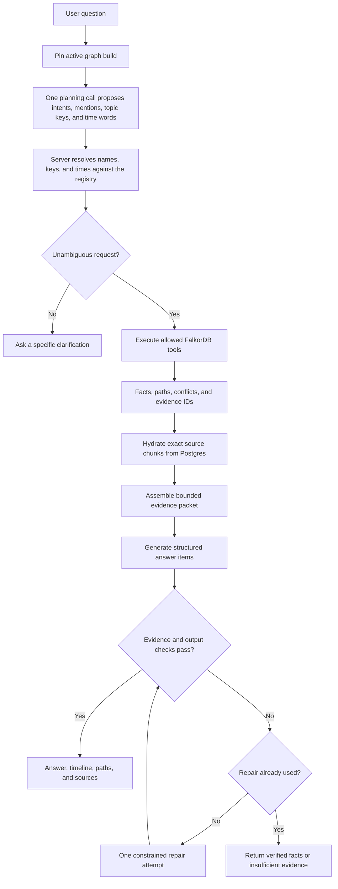

# Query and answer flow

Source of truth for this flow. Read it before changing planning, graph tools, evidence packets,
answer validation, or response shape, and update it in the same change. Step details:
[architecture.md §6](../architecture.md#6-query-and-answer-flow).

Status: pinning, the fixed tools, hydration, and deterministic rendering (LOC-2), plus
natural-language planning, deterministic resolution, multi-step execution on one pinned build, and
`qa_logs` (LOC-4, #12: `src/retrieve/ask.ts`, `resolve-plan.ts`, `plan-prompt.ts`). Answer
generation, output checks, and repair are the next LOC-4 issue; `search_context` follows.

## Invariants

- One graph build is pinned for the whole request.
- Business facts come from fixed, parameterised FalkorDB tools; Postgres only resolves aliases and
  hydrates exact chunk IDs. There is no Postgres answer path when the graph is unavailable.
- Tool inputs are validated before any query runs; the server picks the build and graph name.
- The planner only proposes. Project IDs, topic keys, and times are accepted only after the server
  resolves them against the registry; an ambiguous person or project yields a clarification with
  candidates, an unknown subject yields `insufficient_evidence`, and an invalid plan answers nothing.
- "On D" means the state at the end of D; "before D" means just before D starts (company timezone).
- At most three steps run; extra steps are dropped and the outcome is `partial`.
- "Current at t" and "active at t" are evaluated inside the graph queries: a decision is current if
  decided, effective by t, and not replaced by a replacement effective by t; ownership uses
  `from <= t < to`.
- Excerpts are sliced from Postgres chunk text by the spans on EVIDENCED_BY edges; a mismatch between
  the graph and the source store fails the request as `unavailable` instead of citing anything.
- The repair step runs at most once (enforced in code).
- Outcomes: `answered`, `partial`, `needs_clarification`, `conflicting_evidence`,
  `insufficient_evidence`, `unavailable`.
