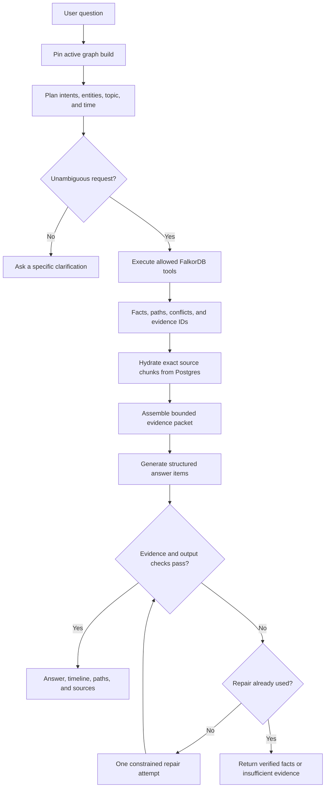

# Query and answer flow

Source of truth for this flow. Read it before changing planning, graph tools, evidence packets,
answer validation, or response shape, and update it in the same change. Step details:
[architecture.md §6](../architecture.md#6-query-and-answer-flow).

Status (LOC-2): pinning, the fixed tools (`get_owner`, `explain_decision`, `get_changes`,
`get_timeline`), exact-ID hydration, alias clarification, and deterministic rendering exist
(`src/retrieve/`, `src/graph/queries.ts`, `src/answer/render.ts`). Requests are structured
(`src/contracts/graph-tools.ts`) until the LOC-4 planner exists; answer generation, output checks,
and repair are LOC-4. `search_context` waits for embeddings (LOC-3).

## Invariants

- One graph build is pinned for the whole request.
- Business facts come from fixed, parameterised FalkorDB tools; Postgres only resolves aliases and
  hydrates exact chunk IDs. There is no Postgres answer path when the graph is unavailable.
- Tool inputs are validated before any query runs; the server picks the build and graph name.
- "Current at t" and "active at t" are evaluated inside the graph queries: a decision is current if
  decided, effective by t, and not replaced by a replacement effective by t; ownership uses
  `from <= t < to`.
- Excerpts are sliced from Postgres chunk text by the spans on EVIDENCED_BY edges; a mismatch between
  the graph and the source store fails the request as `unavailable` instead of citing anything.
- The repair step runs at most once (enforced in code).
- Outcomes: `answered`, `partial`, `needs_clarification`, `conflicting_evidence`,
  `insufficient_evidence`, `unavailable`.
