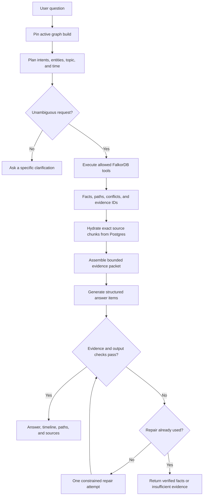

# Query and answer flow

Source of truth for this flow. Read it before changing planning, graph tools, evidence packets,
answer validation, or response shape, and update it in the same change. Step details:
[architecture.md §6](../architecture.md#6-query-and-answer-flow).

Status: not implemented yet (planned for LOC-2 and LOC-4 in [project-plan.md](../project-plan.md)).

## Invariants

- One graph build is pinned for the whole request.
- Business facts come from fixed, parameterised FalkorDB tools; Postgres only resolves aliases and
  hydrates exact chunk IDs. There is no Postgres answer path when the graph is unavailable.
- The repair step runs at most once (enforced in code).
- Outcomes: `answered`, `partial`, `needs_clarification`, `conflicting_evidence`,
  `insufficient_evidence`, `unavailable`.
